<div align="center">


# KanbanHub

**A calm, open-source kanban board for small teams and for yourself.**
Boards, cards, checklists, due dates, time tracking, a calendar and live updates.
No ads, no trackers. Use the hosted version or run your own copy in five minutes.

[**Open KanbanHub**](https://kanbanhub.app) ·
[About the project](https://kanbanhub.app/about) ·
[Run it yourself](https://kanbanhub.app/self-hosting) ·
[Report a bug](https://github.com/danik3422/kanban-flow/issues)

English · [Русский](README.ru.md)

[](LICENSE)


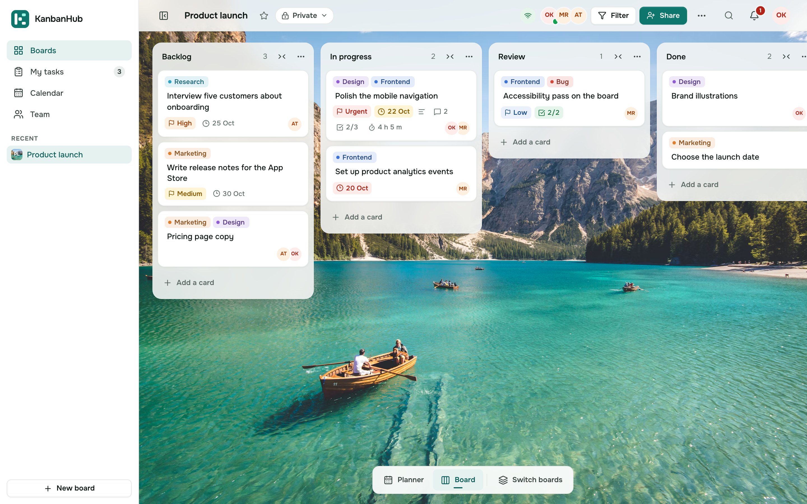

</div>

## Contents

- [What it is](#what-it-is)
- [See it in action](#see-it-in-action)
- [Features](#features)
- [Start using it](#start-using-it)
- [Run your own copy with Docker](#run-your-own-copy-with-docker)
- [Work on the code](#work-on-the-code)
- [How the project is organised](#how-the-project-is-organised)
- [Tech stack](#tech-stack)
- [Privacy](#privacy)
- [Contributing](#contributing)
- [License](#license)

## What it is

KanbanHub is a task board in the style of Trello. You make a board, add lists such as
"To do", "In progress" and "Done", and move cards between them as work moves forward.
Everyone you invite sees changes the moment they happen.

It is built to feel quiet and quick. Nothing blinks at you, there are no upsells, and
nothing about you is sold or tracked. The whole app is open source under the MIT
license, so you can read every line, change it, or run it on your own computer or
server, even with no internet at all.

## See it in action

<p align="center">
  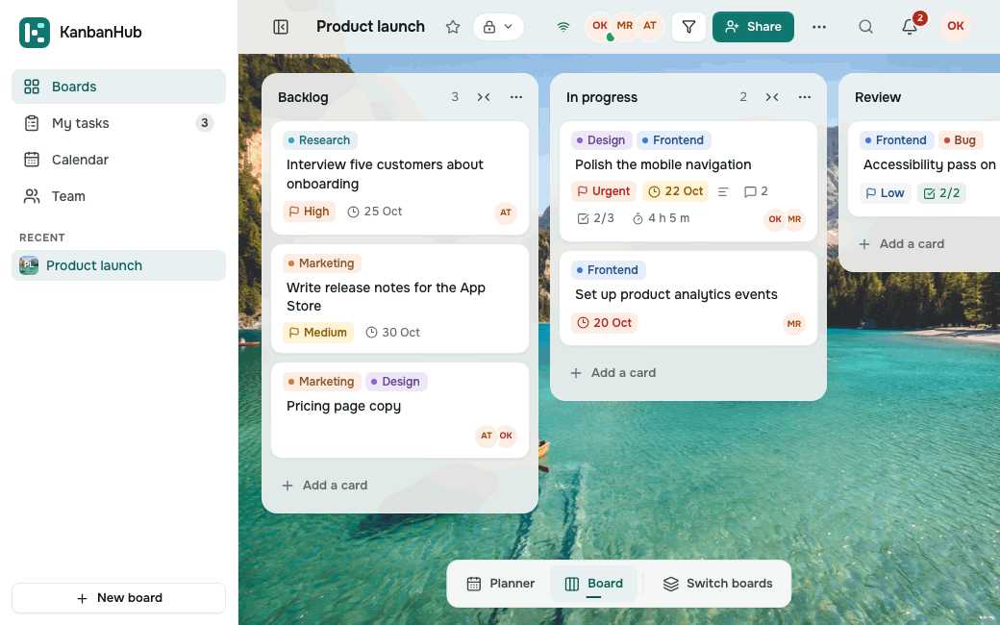
</p>

Drag a card to another list, open it, and everything is right there: members, labels,
dates, priority, a description, a checklist, time tracking and comments.

<table>
  <tr>
    <td width="50%">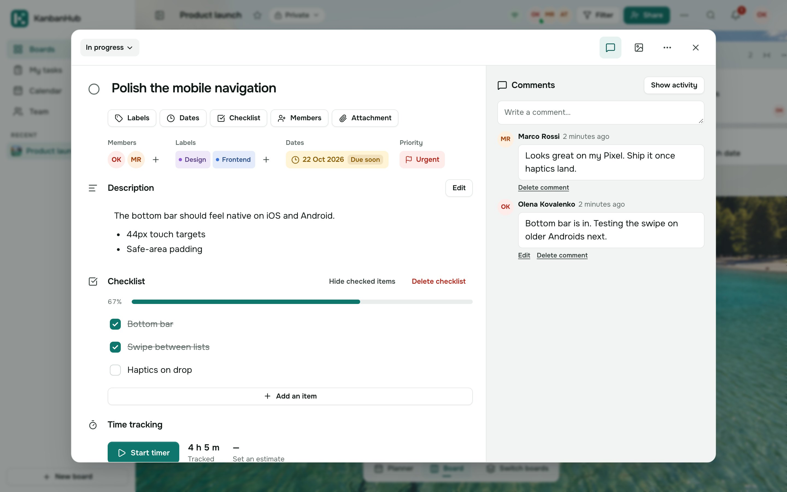</td>
    <td width="50%">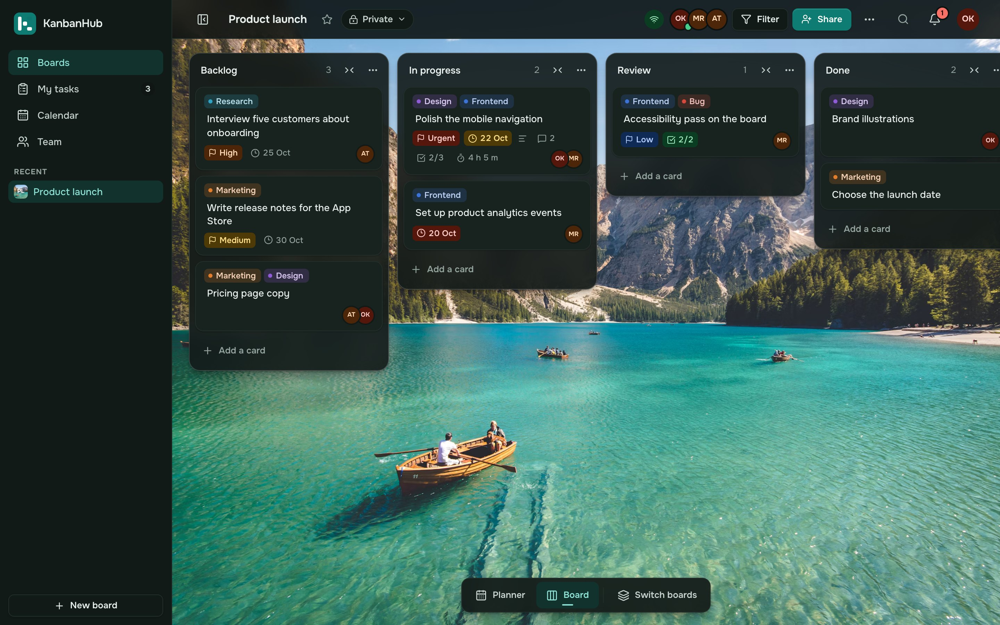</td>
  </tr>
  <tr>
    <td align="center"><b>Everything about a task in one place</b></td>
    <td align="center"><b>Light and dark theme</b></td>
  </tr>
  <tr>
    <td>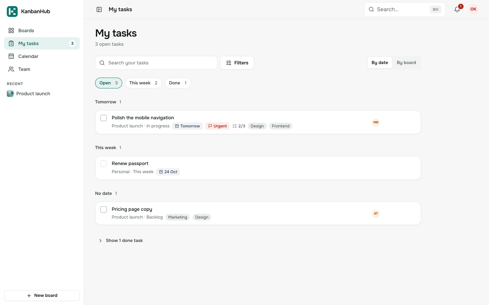</td>
    <td>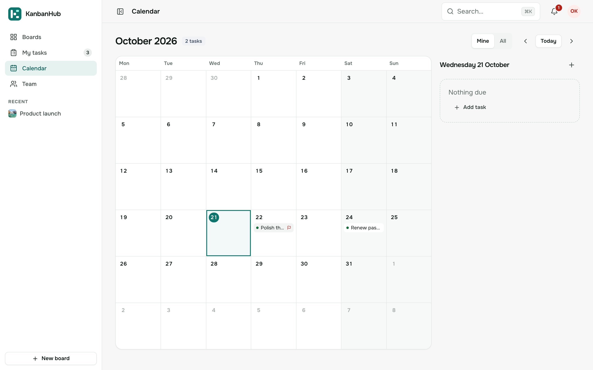</td>
  </tr>
  <tr>
    <td align="center"><b>My tasks across all boards</b></td>
    <td align="center"><b>Calendar of due dates</b></td>
  </tr>
  <tr>
    <td>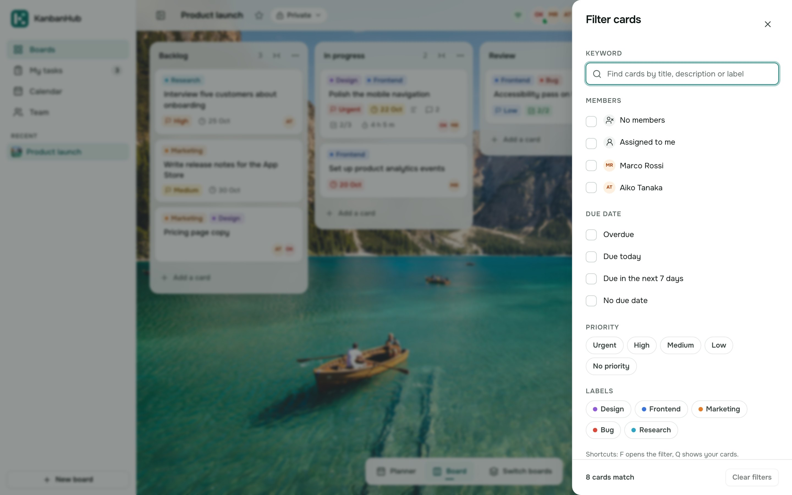</td>
    <td>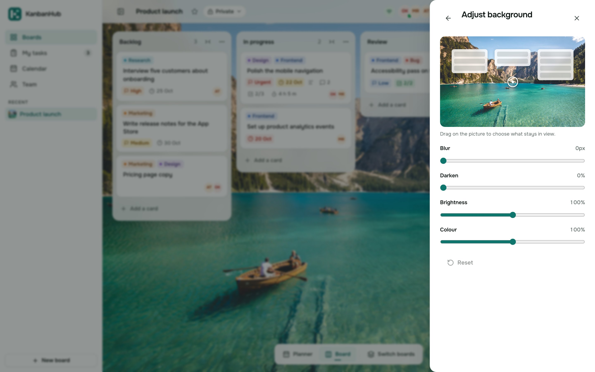</td>
  </tr>
  <tr>
    <td align="center"><b>Filter cards</b></td>
    <td align="center"><b>Your own board background</b></td>
  </tr>
  <tr>
    <td>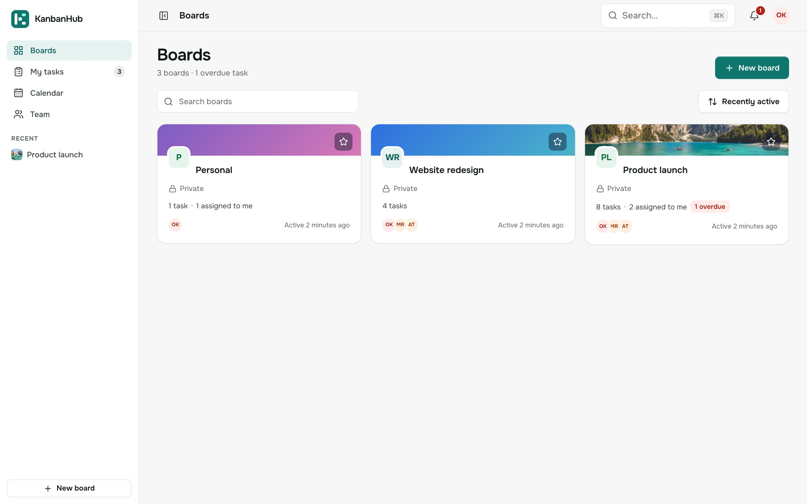</td>
    <td>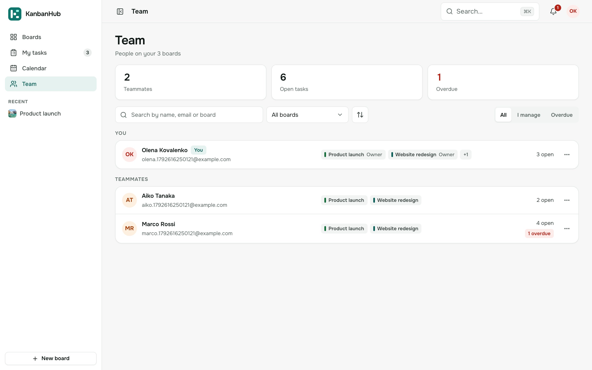</td>
  </tr>
  <tr>
    <td align="center"><b>All boards</b></td>
    <td align="center"><b>Your team</b></td>
  </tr>
</table>

It works just as well on a phone: a bottom bar, swipes between lists and cards that open
as a sheet.

<p align="center">
  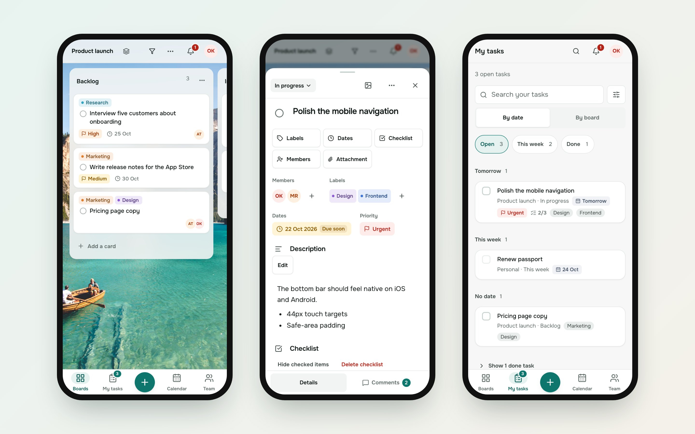
</p>

## Features

**Boards and cards**
- Boards with lists and cards; drag and drop with a mouse or a finger.
- Cards have members, coloured labels, start and due dates, priority, a cover, a
  description with formatting, checklists, attachments and comments.
- Time tracking: start a timer or add time by hand, set an estimate.
- Filter a board by member, label, priority or date. Copy cards, lists and whole boards.
- A board background from a photo library, a colour, or your own picture, with position,
  blur, dimming, brightness and saturation.

**Working together**
- Invite people by link or by email; owner, admin and member roles.
- Live updates: when someone moves a card, you see it move. You also see who is online.
- Notifications in the app and, if you want them, by email: right away or as a digest.
- Share a read-only public link to a board.

**Your day**
- **My tasks**: every card assigned to you, from all boards, grouped by date.
- **Calendar**: cards on their due dates; drag a card to another day to move it.
- Search everything with <kbd>⌘</kbd> <kbd>K</kbd> / <kbd>Ctrl</kbd> <kbd>K</kbd>.

**Everything around it**
- English, Ukrainian and Russian.
- Light, dark or system theme.
- Works offline: if the connection drops, the app still opens and shows everything that
  was already loaded, and tells you that changes have to wait for the network.
- Sign in with email and password, Google or a passkey; see and sign out other devices.

## Start using it

The easiest way is the hosted version: **[kanbanhub.app](https://kanbanhub.app)**.
Make an account, create a board, and invite your team. It is free.

## Run your own copy with Docker

You can run KanbanHub on your laptop, a home server or any VPS. All you need is
[Docker](https://docs.docker.com/get-docker/). It works without internet: no email
service, no cloud storage and no outside accounts are needed.

```sh
git clone https://github.com/danik3422/kanban-flow.git
cd kanban-flow
docker compose up -d
```

Open **http://localhost:8080** and make the first account. That's it.

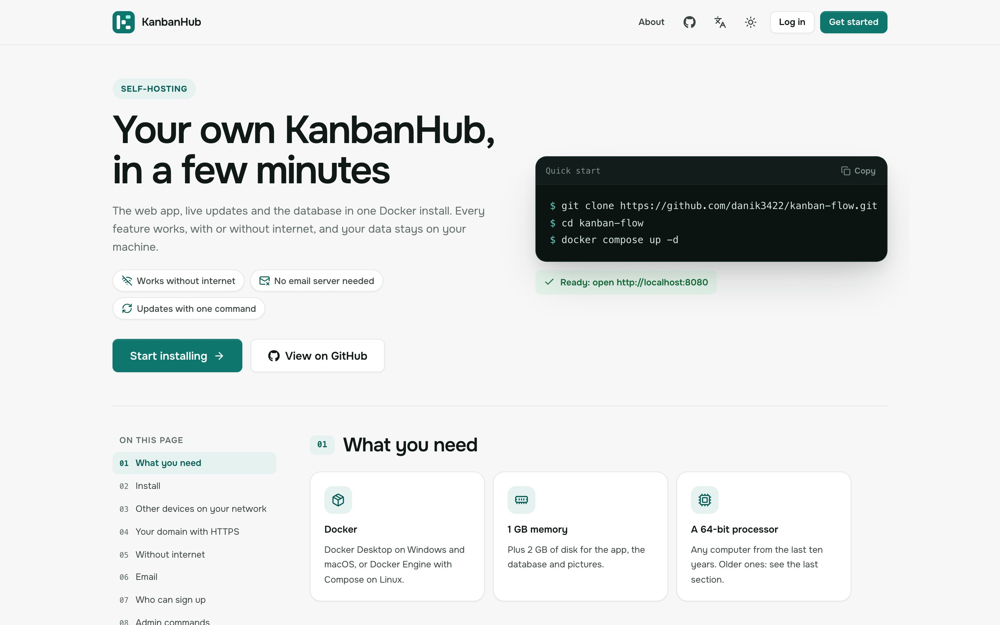

The full guide explains, step by step:

- opening it from other devices on your network;
- your own domain with HTTPS;
- installing on a machine with no internet at all;
- email (optional), who may sign up, and admin commands such as resetting a password;
- updating, backups and restoring, all settings, and troubleshooting.

Read it here: **[kanbanhub.app/self-hosting](https://kanbanhub.app/self-hosting)** or
in this repository as **[SELF_HOSTING.md](SELF_HOSTING.md)**.

## Work on the code

You need **Node.js 24** and npm. MongoDB is optional for development: the server can
start a temporary database in memory.

**1. Get the code and install packages**

```sh
git clone https://github.com/danik3422/kanban-flow.git
cd kanban-flow
npm install
npm --prefix backend install
npm --prefix frontend install
```

**2. Create the settings files**

```sh
cp backend/.env.example backend/.env
cp frontend/.env.example frontend/.env
```

In `backend/.env`, set `JWT_SECRET` to any random string of 32 characters or more. Then
either point `MONGO_URI` at your MongoDB (it must run as a replica set), or set
`ALLOW_MEMORY_DB=true` to use a throwaway in-memory database. Everything else, such as
email, Cloudinary, Firebase or Unsplash, is optional and can stay empty.

**3. Start it**

```sh
npm run dev
```

The web app opens on **http://localhost:5173** and the API runs on port 5001. Both
reload when you save a file.

**4. Check your changes**

```sh
npm --prefix frontend run lint    # code style
npm --prefix frontend test        # web app unit tests
npm --prefix backend test         # API tests (use an in-memory database)
npm --prefix frontend run build   # production build
```

End-to-end browser tests live in `e2e/`: `npm run e2e:start`, then `npm run e2e:flows`,
then `npm run e2e:stop`.

## How the project is organised

```text
kanban-flow/
├── frontend/              the web app (React + Vite)
│   └── src/
│       ├── app/           app shell: routes, sidebar, top bar, offline banner
│       ├── pages/         one file per page
│       ├── features/      code grouped by area: board, boards, calendar, my-tasks,
│       │                  team, notifications, settings, auth, site, ...
│       ├── ui/            shared components and design tokens
│       ├── i18n/          English, Ukrainian and Russian texts
│       ├── lib/           API client, cache, offline support, helpers
│       ├── store/         app state (zustand)
│       └── sw/            service worker for offline use
├── backend/               the API (Express + MongoDB + Socket.IO)
│   ├── routes/            URLs → handlers
│   ├── controllers/       request handlers
│   ├── services/          shared logic: access checks, notifications, files
│   ├── models/            database models
│   ├── validation/        request schemas
│   ├── middlewares/       auth, CSRF, rate limits
│   ├── realtime/          live updates and presence
│   ├── emails/            email templates and jobs
│   ├── scripts/           migrations and admin commands
│   └── test/              API tests
├── e2e/                   browser tests (Playwright)
├── docker/                container start script
├── Dockerfile             one image: API + built web app
├── docker-compose.yml     the app and MongoDB, ready to run
├── SELF_HOSTING.md        guide for running your own copy
└── DEPLOYMENT.md          notes for the hosted version
```

More detail on the server: [backend/README.md](backend/README.md).

## Tech stack

| Part | What it uses |
| --- | --- |
| Web app | React 19, Vite, React Router, zustand, dnd-kit, lucide icons |
| Server | Node.js 24, Express 5, Mongoose, Socket.IO, zod, helmet |
| Database | MongoDB 8 (replica set) |
| Offline | Service worker and IndexedDB cache |
| Tests | Node test runner, supertest, Playwright |
| Running it | Docker and Docker Compose |

## Privacy

There is no analytics, no ad trackers and no selling of data. The hosted version uses a
few outside services only to work: hosting, sending email, storing pictures, the photo
library for backgrounds and Google sign-in. A self-hosted copy can run with none of
them. Read more on the [About page](https://kanbanhub.app/about).

## Contributing

Bug reports, ideas and pull requests are welcome.

- Found a bug or have an idea? [Open an issue](https://github.com/danik3422/kanban-flow/issues/new/choose).
- Want to change the code? See [CONTRIBUTING.md](CONTRIBUTING.md).
- Found a security problem? Please report it privately, as described in [SECURITY.md](SECURITY.md).

## License

[MIT](LICENSE). You are free to use, change and share KanbanHub, including for work.

Made by [Danylo Syloats](https://danylodev.com).
